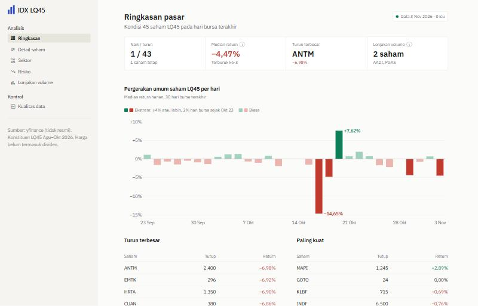
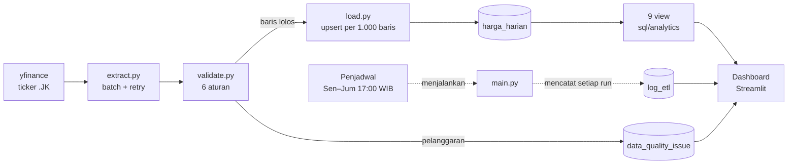
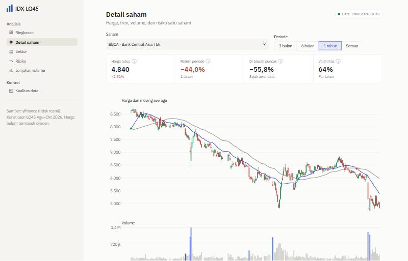
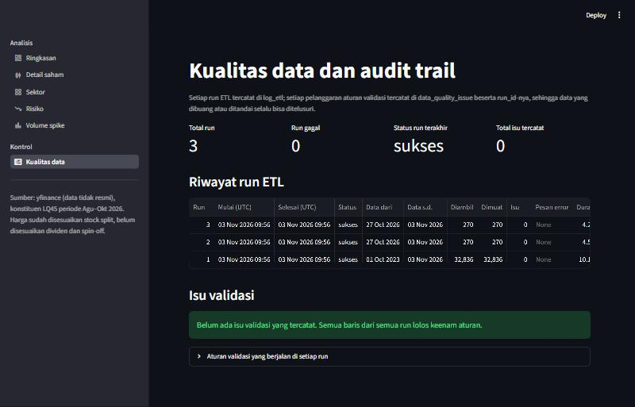
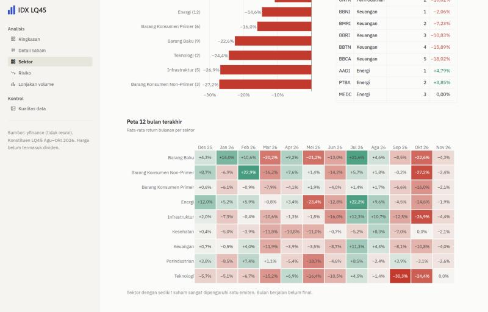

# IDX LQ45 Data Pipeline

Pipeline ETL harian untuk harga saham 45 konstituen **LQ45 Bursa Efek Indonesia**: data diambil dari yfinance,
divalidasi dengan **6 kontrol kualitas data** yang terdokumentasi, dimuat secara **idempotent** ke PostgreSQL,
dianalisis dengan **SQL window function**, lalu disajikan di dashboard Streamlit.

**Dashboard:** https://idxetl-7fmnwav7bb3xc4i4fpkirz.streamlit.app



| | |
|---|---|
| Cakupan | 45 saham LQ45 · Okt 2023 – sekarang · ±32.800 baris harga harian |
| Kontrol data | 6 aturan validasi, setiap pelanggaran tercatat dengan `run_id` (audit trail) |
| Analitik | 9 view SQL: return, moving average, volatilitas, ranking sektor, volume spike, drawdown, pergerakan pasar harian |
| Kualitas kode | 51 test (pytest), keputusan desain tercatat di [DECISIONS.md](DECISIONS.md) (#001–#016) |
| Stack | Python 3.12 · pandas · yfinance · SQLAlchemy + psycopg2 · PostgreSQL 16 · Streamlit + Plotly · Docker · GitHub Actions · Neon |

## Arsitektur



- **Database**: PostgreSQL 16 di Docker untuk pengembangan, **Neon** (PostgreSQL serverless) untuk produksi.
  Koneksi dipilih lewat `DATABASE_URL`; tanpa variabel itu, pipeline memakai database lokal.
- **Jadwal**: Windows Task Scheduler menjalankan ETL 7 hari terakhir setiap hari bursa; jika laptop mati pada jamnya,
  run menyusul saat laptop menyala. Workflow GitHub Actions (test, `setup_db`, lalu ETL) tersedia sebagai alternatif.
- **Dashboard**: Streamlit Community Cloud, hanya membaca view; semua perhitungan ada di SQL.



## Yang membuat pipeline ini bisa dipercaya

**Idempotent.** Primary key `(kode, tanggal)` + `INSERT ... ON CONFLICT DO UPDATE`. Run harian sengaja mengambil 7 hari
terakhir (tumpang tindih dengan run sebelumnya) agar data yang terlambat atau dikoreksi sumber ikut masuk, tanpa duplikasi.
Dibuktikan dengan menjalankan ETL berulang: jumlah baris tidak berubah.

**Kontrol kualitas data dengan perlakuan berbeda per aturan.**

| Aturan | Perlakuan | Kenapa |
|---|---|---|
| `tanggal_masa_depan` | dibuang + dicatat | tidak mungkin ada harga untuk hari yang belum terjadi |
| `harga_tidak_positif` | dibuang + dicatat | harga ≤ 0 atau kosong merusak perhitungan return |
| `ohlc_tidak_konsisten` | dibuang + dicatat | high di bawah open/close (atau low di atas) mustahil |
| `volume_negatif` | dibuang + dicatat | volume 0 sah, negatif tidak |
| `duplikat` | salinan pertama yang valid disimpan | data tidak hilang, tidak ada baris ganda |
| `lonjakan_ekstrem` | **disimpan** + dicatat | bisa nyata (corporate action); batas ARA/ARB BEI **per periode berlaku** |

Batas ARA/ARB mengacu pada Siaran Pers BEI No. 083/BEI.SPR/09-2026. Kalibrasinya diuji pada data: menerapkan ARB 15%
(aturan saat ini) ke seluruh histori akan salah menandai 11 penurunan sah sebelum April 2025, ketika ARB masih simetris.

**Audit trail.** Setiap run tercatat di `log_etl` (status, rentang tanggal, jumlah baris, durasi, pesan error), dan setiap
pelanggaran di `data_quality_issue` beserta `run_id`. Keduanya ditampilkan di halaman *Kualitas data* dashboard.



**Diukur sebelum dioptimasi.** Pada backfill 32.521 baris: extract 5,9 s, validasi 0,3 s, **load 62,3 s**. Bottleneck-nya
round trip (satu INSERT per baris), jadi load diganti `execute_values` (1.000 baris per perintah): **62 s → 4 s**.
Backfill penuh ke database cloud selesai dalam ±10 detik.

## Temuan (data 2 Okt 2023 – 3 Nov 2026)

Angka di bawah adalah *price return* (tidak termasuk dividen).

1. **Periode ini pasar turun lebar.** 37 dari 45 saham turun; median −31%. Empat bank besar turun 38–49%
   (BBRI −49%, BBCA −47%, BMRI −41%, BBNI −38%). Kenaikan terkonsentrasi di sedikit saham: WIFI +386%, HRTA +221%, DEWA +171%.
2. **Guncangan serentak bertepatan dengan batas ARB.** Pada 16 Okt 2026 seluruh 45 saham turun dengan median −14,7%,
   hampir persis batas ARB 15%. Pada 8 Apr 2025, 44 dari 45 saham turun (median −10,1%).
3. **Volume spike menandai hari bergejolak.** Dari 1.039 hari dengan volume > 3× rata-rata 20 hari, median pergerakan
   harga absolutnya 5,3%, sekitar 3,8× hari biasa (1,4%).
4. **Risiko besar dan saling terkait.** Median drawdown maksimum −58% (terdalam CUAN −86%). Saham dengan volatilitas
   tinggi cenderung punya drawdown lebih dalam (korelasi −0,58).
5. **MA20/MA50 crossover banyak sinyal palsu.** 663 crossover dalam 3 tahun (±15 per saham): tanpa filter lain,
   sinyal ini sering berbalik.
6. **Juara bulanan ≠ juara jangka panjang.** Barang Baku paling sering menjadi sektor terbaik bulanan (8 bulan),
   tapi rata-rata return kumulatifnya −31%. Sektor dengan 1–3 saham sangat dipengaruhi satu emiten.



## Struktur repo

```
src/idx_pipeline/
  extract.py     # yfinance per batch 20 ticker, retry + exponential backoff
  validate.py    # 6 aturan validasi, batas ARA/ARB per periode
  load.py        # upsert idempotent (execute_values), log run, catat isu
  main.py        # CLI ETL: --start / --end
  setup_db.py    # buat/perbarui tabel + view di database tujuan (idempotent)
  config.py      # DATABASE_URL atau POSTGRES_*
sql/schema/      # tabel: emiten, harga_harian, log_etl, data_quality_issue
sql/analytics/   # 7 file → 9 view analitik
dashboard/       # Streamlit: app.py, ui.py (komponen), fmt.py (format Indonesia), 6 halaman
tests/           # 51 test: validasi, extract (tanpa internet), config, format
config/tickers.csv
.github/workflows/etl.yml
DECISIONS.md     # 16 keputusan desain: alternatif, alasan, konsekuensi
```

## Menjalankan secara lokal

```bash
cp .env.example .env
docker compose up -d                              # PostgreSQL 16 + skema dibuat otomatis
pip install -r requirements.txt
export PYTHONPATH=src                             # PowerShell: $env:PYTHONPATH="src"
python -m idx_pipeline.setup_db                   # tabel + view (aman diulang)
python -m idx_pipeline.main --start 2023-10-01    # backfill
python -m idx_pipeline.main                       # run harian: 7 hari terakhir
python -m streamlit run dashboard/app.py          # http://localhost:8501
pytest -q
```

## Deploy

1. **Neon**: buat proyek (region Singapore) dan salin connection string *pooled*.
2. **Isi database dari nol**: set `DATABASE_URL`, jalankan `setup_db` lalu `main --start 2023-10-01`.
3. **Jadwal ETL** (pilih salah satu; keduanya menjalankan ETL 7 hari terakhir Senin–Jumat 17:00 WIB):
   - **Windows Task Scheduler** (yang dipakai saat ini): simpan connection string di `.env.neon`, lalu daftarkan
     `scripts\etl_terjadwal.cmd <path python.exe>` sebagai tugas terjadwal dengan opsi *jalankan secepatnya jika jadwal terlewat*.
     Log tersimpan di `logs/etl.log`.
   - **GitHub Actions**: tambahkan secret `DATABASE_URL`; workflow `ETL harian` menjalankan test lalu ETL, dan bisa
     dijalankan manual dengan tanggal mulai opsional.
4. **Streamlit Community Cloud**: main file `dashboard/app.py`, secret `DATABASE_URL = "..."`.

ETL ke database tertentu dari laptop: `python -m idx_pipeline.main --env-file .env.neon`.

## Keterbatasan dan rencana perbaikan

| Keterbatasan | Dampak | Rencana |
|---|---|---|
| yfinance bukan sumber resmi | bisa ada tanggal hilang atau koreksi | validasi + run 7 hari tumpang tindih; bandingkan dengan data resmi IDX |
| `Close` Yahoo disesuaikan split, **tidak** dividen | return = price return, bukan total return; spin-off terbaca sebagai penurunan | simpan `Adj Close` di kolom terpisah |
| Split baru menyesuaikan seluruh histori di Yahoo, run harian hanya 7 hari | "patahan" skala harga di database (akan tertandai `lonjakan_ekstrem`) | deteksi otomatis lalu backfill ulang saham tersebut |
| Daftar LQ45 satu periode dipakai untuk seluruh histori | *survivorship bias* | tabel histori konstituen per periode |
| `lonjakan_ekstrem` tidak memeriksa baris pertama tiap batch | satu hari per run tidak diperiksa | ambil harga terakhir dari database sebagai acuan |
| Isu validasi tercatat ulang setiap run | laporan perlu filter run terakhir | deduplikasi isu per (kode, tanggal, aturan) |
| Ticker yang tetap kosong hanya masuk log | tidak terlihat di dashboard | catat sebagai isu `data_kosong` |

Detail setiap keputusan, alternatif yang ditolak, dan konsekuensinya ada di [DECISIONS.md](DECISIONS.md).
